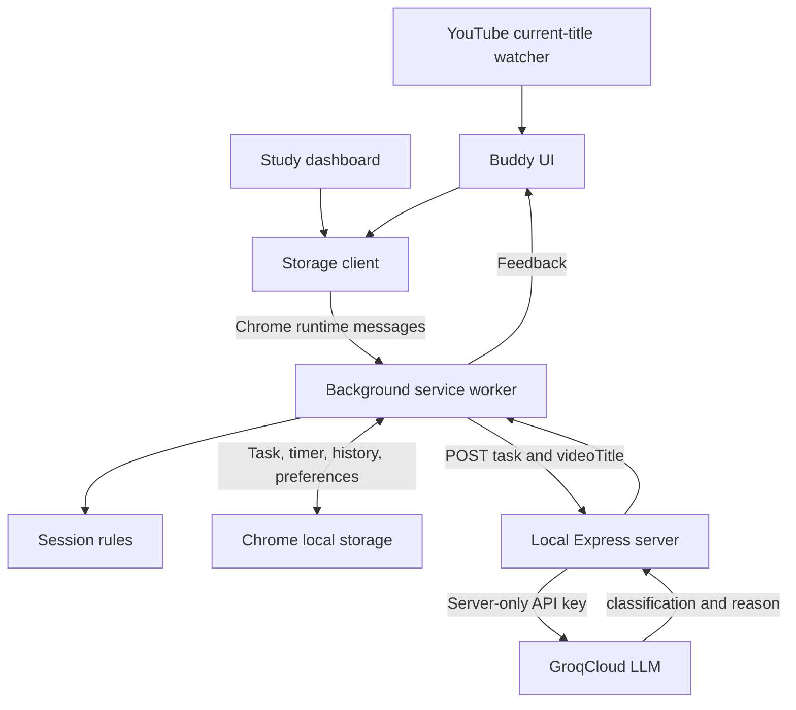

# Lock-In Buddy

A local-first Chrome extension MVP built with vanilla JavaScript, HTML, and CSS. A draggable Buddy on YouTube and Google helps you set a task, run a shared focus timer, and check in through preset chat replies. The dashboard turns saved study sessions into statistics. Optional AI checks compare the current YouTube video's title with your actual task through a small Node.js/Express backend and GroqCloud.

Tasks, timers, history, and the dashboard work without a backend. **AI classification requires the Express backend to be running, an internet connection, and your own Groq API key.** This CS portfolio project has no build step, database, user authentication, or deployment infrastructure.

## Features

- Draggable Buddy, task and optional first step, and a 5-, 10-, or 25-minute focus timer.
- Start, pause, resume, reset, and early completion through `done` in chat.
- One shared task, timer, and conversation across YouTube, Google, and the extension dashboard.
- Persistent task, latest 100 chat messages, timer, and website-specific position/panel/tab preferences.
- Study history: task, start/end dates, planned duration, actual timer-running time, and completed/reset result.
- Dashboard: today's study time, completed sessions, total study time, average completed-session duration, current focus, and paginated history.
- Dashboard access from the extension toolbar icon, with Buddy available on the dashboard.
- Keyboard controls, responsive layout, safe text rendering, and storage errors with loading retries.
- Opt-in AI YouTube relevance checks: `relevant`, `distracting`, or `uncertain`, with a reason based on the actual saved task.
- Friendly reminders in Buddy and beside its closed widget; videos continue playing.
- SPA navigation handling, duplicate suppression, cached results, and graceful backend failures.

## Technologies

| Area | Technologies |
| --- | --- |
| Frontend | JavaScript, DOM APIs, HTML, scoped CSS |
| Extension | Chrome Manifest V3, content scripts, service worker, Storage, Alarms, runtime messaging |
| Backend | Node.js 22.21+ (24 LTS recommended), Express 5, `express-rate-limit`, built-in `fetch` and `process.loadEnvFile` |
| AI | GroqCloud's official REST Chat Completions API, `openai/gpt-oss-20b`, strict JSON structured output |
| Testing | Node's built-in test runner, VM contexts, fake Chrome APIs, Playwright/Chromium, mocked Groq responses |

## Install the extension

1. Download or clone the project.
2. Open `chrome://extensions` in current desktop Chrome and enable **Developer mode**.
3. Choose **Load unpacked** and select the project root containing `manifest.json`.
4. Pin **Lock In Buddy** using Chrome's extensions menu. Click its icon to open the dashboard.
5. Visit `https://www.youtube.com/` or `https://www.google.com/`, open Buddy, save a task, choose a duration, and start.

After updating code, **Reload** the extension's card and refresh existing website/dashboard tabs. Existing task, timer, chat, and history data remain compatible.

## Configure and start AI analysis

1. Install Node.js **22.21 or newer** (24 LTS recommended). Install dependencies from the project root:

   ```bash
   npm ci
   ```

2. Create an API key in [GroqCloud's console](https://console.groq.com/keys). On first setup, create **`server/.env`** from the example:

   ```bash
   cp server/.env.example server/.env
   ```

   On Windows you can copy the file using your editor or File Explorer. Edit `server/.env` locally:

   ```dotenv
   GROQ_API_KEY=your_key_here
   ```

   Replace the placeholder with your real key. Keep it out of chat, screenshots, and extension code. `.env` files are ignored by Git; only `.env.example` belongs in the repository.

3. Start the backend from the project root and leave the terminal running:

   ```bash
   npm run start:server
   ```

   It listens on **`http://127.0.0.1:3000`**. Restart after changing `.env`. If port 3000 is busy, stop the other process using that port. The extension uses this fixed local address; remote hosting is outside this MVP.

4. Reload the extension and refresh your YouTube tab. Open Buddy and enable **Check YouTube relevance with AI**. The checkbox explains that your saved task and current video title are sent to the local analysis service and GroqCloud. The preference persists across extension tabs and browser restarts.
5. Save a task and start/resume the timer on a YouTube watch page. Buddy checks the title and rechecks when the task, video, or focus session changes. Paused, idle, completed, and expired timers do not trigger requests. Disable the checkbox to stop checks and discard pending feedback.

The server reads the key only through `process.env.GROQ_API_KEY`, after Node's built-in `process.loadEnvFile` loads `server/.env`. The extension never receives the key. The model is on Groq's [free-plan limits list](https://console.groq.com/docs/rate-limits) and supports [strict structured outputs](https://console.groq.com/docs/structured-outputs); availability and account quotas can change. Automated tests do not use your key or spend API credits.

### API contract

`POST /api/analyze` accepts `Content-Type: application/json` and exactly two nonempty strings, each at most 500 characters. Whitespace is trimmed; request bodies are limited to 4 KB.

```json
{ "task": "Study Calculus", "videoTitle": "Integration by Parts Tutorial" }
```

A successful response has HTTP status `200`:

```json
{ "classification": "relevant", "reason": "The video explains an integration technique used in calculus." }
```

Classifications are `relevant`, `distracting`, and `uncertain`. Errors return `{ "error": "code", "message": "friendly explanation" }`, without a fabricated classification or raw provider details:

| Status | Meaning |
| --- | --- |
| `400` | Invalid fields or malformed JSON |
| `403` | Ordinary website origin rejected |
| `413` / `415` | Oversized body / wrong content type |
| `429` | Local request limit or Groq rate limit |
| `502` | Groq HTTP/network failure or unexpected model output |
| `503` | Missing or placeholder API key |
| `504` | Groq exceeded the 10-second timeout |
| `500` | Unexpected server error |

Try a request after starting Express (shell example):

```bash
curl http://127.0.0.1:3000/api/analyze \
  -H 'Content-Type: application/json' \
  -d '{"task":"Study Calculus","videoTitle":"Integration by Parts Tutorial"}'
```

This manual request calls Groq when a key is configured. Without a key it returns `503`. The server limits `/api/analyze` to 10 requests per minute per IP; local extension tabs share that limit.

## How study time is counted

Study time means **time the focus timer is running**, not a measurement of attention or activity. Switching tabs, closing tabs, restarting the browser, and putting the computer to sleep do not pause it. Pause explicitly for breaks. A late completion is dated at the timer's deadline and cannot exceed the planned duration.

| Action | History and statistics |
| --- | --- |
| Start | Creates a session ID and running interval |
| Pause | Saves elapsed milliseconds and exact remaining time; no final history row yet |
| Resume / `more time` while paused | Continues the same session ID; paused time is excluded |
| Timer expires | Saves one completed record, even if several tabs check at once |
| `done` while running or paused | Records elapsed active time as completed early |
| `done` without an active timer | Marks the task done without inventing a focus session |
| Reset, change task/first step, or change duration while paused | Saves nonzero partial time as reset; does not increase completed sessions |
| Start again / `more time` after completion | Creates a new focus session |

Zero-time sessions create no history row. Reset retains the task and chat. Duration changes are disabled while running. Editing the task or first step resets the timer and records partial time against the original task/duration.

Today's total includes active, paused, completed, and reset time between local midnight and now. Running intervals split correctly across midnight. The completed count and average include early completion; resets contribute only to time totals. History dates use the viewer's local timezone. Displayed durations round down to seconds (hours display minutes); stored time uses milliseconds.

Chat uses explicit preset commands, independently of AI:

| Message | Effect |
| --- | --- |
| Task description when no task is set | Saves it as the task |
| `start`, `resume`, or `more time` | Starts/resumes the timer |
| Message containing `break`, `tired`, or `rest` | Pauses a running timer |
| `done` or `finished` | Completes the task and finishes an active session |

Completion commands match the entire message, so “not done” does not complete a task.

## Architecture



| File | Responsibility |
| --- | --- |
| `session.js` | Plain-data session rules, validation, intervals, history, and statistics |
| `background.js` | Single session writer, command queue, storage, completion alarms, dashboard action, and AI message routing |
| `storage.js` | UI adapter for worker commands and session/settings subscriptions; separate preview storage |
| `appear.js` | Buddy HTML, including AI consent and feedback controls |
| `buddy.js` | Forms, preset chat, dragging, keyboard behavior, rendering, errors, and AI feedback |
| `styleBuddy.css` | Scoped widget styling |
| `dashboard/index.html`, `script.js`, `styles.css` | Dashboard markup, shared-state rendering, and responsive styles |
| `manifest.json` | Manifest V3 worker, content scripts, storage/alarm permissions, and loopback host permission |
| `analysis.js` | Opt-in settings, worker HTTP client, request deduplication, bounded cache, and timeout |
| `youtube.js` | Current title, SPA navigation, running-session gate, and stale-result protection |
| `server/index.js` | Loads the environment and starts the server on loopback |
| `server/app.js` | Express route, JSON validation, origin checks, rate limiting, and error responses |
| `server/groq.js` | Server-only Groq REST call, task-based prompt, strict schema, timeout, and output validation |
| `server/.env.example` | Configuration template with no real key |

Content scripts load in order: `session.js` → `analysis.js` → `storage.js` → `youtube.js` → `appear.js` → `buddy.js`. The dashboard omits the YouTube watcher and then loads its renderer. The worker loads `session.js` and `analysis.js` with `importScripts`.

### Backend concepts

**Node.js** runs JavaScript outside the browser. `npm ci` installs the packages in `package-lock.json`. Dependencies/scripts are managed at the project root; no second install inside `server/` is needed.

**Express routes and middleware.** A route handles an HTTP method and path. Middleware runs first: origin checking and rate limiting restrict requests, and `express.json` parses JSON into `request.body`. The handler validates that body, awaits Groq, and sends JSON with an HTTP status. Error middleware centralizes safe failure responses.

**Environment variables.** Node loads local `.env` configuration into the server's `process.env`, keeping secrets out of source and the extension. Missing keys leave Express running so it can return a helpful `503`.

**Timeouts and test injection.** `AbortController` cancels a stalled request, including response-body reads. Factories accept a `fetchImpl` function, allowing tests to replace the network boundary while exercising the real route, prompt, parsing, and validation.

### Engineering decisions

**Commands instead of whole-state replacements.** Each UI sends an intention such as `{ type: 'pause' }`. The worker reads the latest snapshot before applying it. An old tab cannot overwrite newer task/history data with an outdated snapshot.

**One writer and one session snapshot.** The worker queue serializes session commands, alarms, and startup reconciliation. Sessions, active intervals, and history share `lock-in-buddy-session-v1` in `chrome.storage.local`. Completion/history are saved together. Stable session IDs and completed status prevent duplicate records. Failed writes leave the previous state available for retry and do not stop the queue.

**Timestamps instead of ticking storage writes.** Running timers save `endTime`; each UI paints `ceil((endTime - Date.now()) / 1000)`. Pausing saves exact remaining time and closes the interval; resuming opens another. Short pauses do not lose time through rounding, and countdowns recover after reload/restart.

**Temporary workers, durable storage.** Startup, worker wake, alarms, and visible-tab reconciliation repair missing alarms and expired timers. Late completion records are capped at the original deadline.

**Shared data, separate preferences.** Storage events update clients; session revisions prevent stale rendering. Position/panel/tab preferences have separate keys per website. AI opt-in has its own shared key, `lock-in-buddy-ai-v1`. User/model text is rendered with `textContent`.

**AI separate from session writes.** The worker checks the saved task and opt-in/running state before calling Express and again before returning feedback. It verifies the sender's YouTube origin; the content script checks the current watch-page URL. Chrome can retain the document's original sender URL during SPA navigation, so the worker does not use that old path to reject homepage-to-video navigation. Network work runs outside the session queue, so outages cannot delay pause/reset/history. AI feedback does not modify study history or shared chat.

**Minimal requests.** YouTube events, a debounced observer, and a one-second local fallback notice navigation/title changes. Local scans send no requests for an unchanged video/session. The worker merges matching calls across tabs, caches up to 50 task/title results for five minutes, and holds errors for one minute to prevent repeated retries. There are no automatic provider retries. Old responses are discarded after video/task/session/opt-in changes.

## Privacy

Study data and the AI preference are stored locally in your Chrome profile. AI is **off by default**. When enabled during a running session on a YouTube watch page, only the saved task and current video title go to the local backend, then GroqCloud. Video IDs are used locally for navigation and are not sent to Express. No transcript, description, comments, full browsing history, chat, study history, or private page content is uploaded. See [Groq's data policy](https://console.groq.com/docs/your-data) before using sensitive task names.

Permissions are `storage`, `alarms`, and `http://127.0.0.1/*` for the worker's backend request. Chrome host patterns cover all ports on that host; the code calls only port 3000. Creating the dashboard tab needs no browsing-history permission. The extension uses no Chrome sync or external fonts. Uninstalling removes extension storage; local data is not an encrypted backup.

Express binds only to `127.0.0.1`, accepts extension origins and requests without an Origin header (such as curl), rejects ordinary website origins, and does not log/store task/title bodies. Its limiter is in memory. This local learning server has no authentication and is intended for your own computer.

## Automated tests

Use Node.js 22.21 or newer. Backend tests open temporary loopback HTTP servers. Install dependencies once:

```bash
npm ci
npm test
# Targeted milestones:
npm run test:server
npm run test:ai
node tests/session.test.cjs
```

Tests cover exact pause accounting, early completion, partial resets, midnight boundaries, invalid actions/data, failed storage writes/retry, concurrent tabs/alarms, worker restart, alarm restoration, UI isolation, toolbar action, and dashboard history. AI/backend tests cover all classifications, inputs, missing keys, Groq errors/timeouts, rate limits, duplicate requests, task/video changes, opt-in, stale results, cancellation, and extension/backend payloads. `tests/extension-fixture.cjs` supplies shared fake Chrome APIs.

For real Chromium extension tests:

```bash
npx playwright install chromium
npm run test:browser
# AI browser workflows only:
npm run test:browser:ai
```

Linux may need Playwright's system libraries (`npx playwright install --with-deps chromium`). Set `CHROMIUM_EXECUTABLE_PATH` to use an existing compatible Chromium executable.

Browser AI tests use an isolated temporary Express port and a temporary copy of the extension assets pointed at that port. Your normal backend can keep running on port 3000. Tests exclude `server/.env`, supply a dummy key directly, and never call real Groq.

Browser tests use a temporary profile and mocked Google/YouTube pages, running the real extension. They check dragging/keyboard controls, refresh, cross-site synchronization, dashboard statistics/history, early completion/reset, mobile layout, browser restart, standalone preview, and the extension → Express → mocked Groq flow. AI cases include SPA navigation, all feedback states, opt-in persistence, and backend shutdown/restart. Deadlines are accelerated instead of waiting five minutes. Profiles are removed; screenshots go to the OS temporary directory.

The MVP includes **51 unit/integration tests** and **13 browser workflow groups** (the original 9 plus 4 AI groups), including homepage-to-video navigation without a full refresh. Automated tests establish integration behavior; assess classification accuracy with your own live Groq account. Fixtures cannot establish compatibility with every live Google/YouTube change. Browser restarts are graceful close/reopen, not power-loss simulations. Headless Playwright opens the toolbar destination URL; the toolbar handler itself is unit tested.

## Manual demonstration

1. Start a five-minute task on YouTube and refresh. Confirm task/countdown persist.
2. Open Google and the toolbar dashboard. Confirm shared task and timer everywhere.
3. Pause on Google; dashboard study time should stop increasing. Resume on YouTube.
4. Send `done`; confirm one **Completed early** row below the planned duration.
5. Start again, wait briefly, then reset; confirm **Reset · partial** without increasing completed count.
6. Restart Chrome and confirm history and the running countdown return.
7. Let a timer expire with multiple tabs open; confirm one check-in/history record. With no website tabs open, the alarm or next wake/load completes it.
8. Drag, refresh, resize, and navigate between YouTube videos. Verify one widget and reachable controls. Try Tab, arrow keys on Buddy tabs, and Escape.

### Manual AI demonstration

1. Start Express with your key. Leave checks off, start a YouTube focus session, and confirm no check runs until you enable the checkbox.
2. With **Study Calculus**, open an integration tutorial. Expect `relevant` with a short explanation.
3. Navigate within YouTube to a gameplay/highlights video such as **Minecraft Funny Moments**. Expect `distracting` with a friendly reminder. Close the panel to see its small reminder; playback/website controls remain usable.
4. Save **Research Video Game Development**, restart the timer, and open a video such as **How Minecraft Was Programmed**. Expect `relevant` despite the gaming subject.
5. Try a vague task/title. An `uncertain` result should say Buddy is unsure and let you decide. AI can disagree with these expectations; titles alone are imperfect evidence.
6. Pause and navigate to another video; no check should run. Resume and confirm the current title is checked. Disable checks and confirm reminders disappear and new navigation stops sending titles.
7. Stop Express and open a different, uncached video while focusing. Confirm neutral failure feedback and working pause/reset/dashboard controls. Restart Express, wait one minute for the error cooldown, and choose **Check again**.
8. Test without a configured key to see `503`, then restore it locally. Refresh/restart Chrome to check persistence. Never share your key during a demo.

## Standalone development preview

```bash
python3 -m http.server 8000 --bind 127.0.0.1
```

Visit `http://127.0.0.1:8000/dashboard/`. The labeled preview uses **separate** `localStorage` data; storage events/Web Locks coordinate tabs and a custom event updates clients within one page. It cannot read extension data and has no worker/alarm, so expiry is reconciled when a preview tab is open again. Use localhost rather than `file://` for dependable synchronization.

AI controls are disabled in preview; use the installed extension on YouTube for AI testing. Keep the preview server bound to loopback since it serves the project directory.

## Known limitations

- Only `www.youtube.com` and `www.google.com` are supported; regional Google domains, Gmail, and Docs are excluded.
- Running time includes time away, asleep, or with Chrome closed. It does not prove focus. Clock changes affect timers; timezone changes affect today's grouping.
- AI uses titles only and can misclassify relevance. It does not measure attention, inspect video contents, or block videos. Task/title text can influence output despite instructions to treat it as data.
- AI supports standard `www.youtube.com/watch?v=...` pages; Shorts, embedded players, and the mobile site are excluded. YouTube DOM/event changes can require selector updates.
- Express must run on port 3000; Groq needs internet and available model/account quota. Outages leave the timer/dashboard usable.
- Worker caches and server limits are in memory. Worker suspension/restart clears cached results and can cause a fresh check on a later visit. Server restart clears limits. Unchanged videos are not repeatedly refreshed; errors can be retried after one minute.
- Disabling checks cancels the extension's pending request and discards feedback, but cannot recall data already sent to Express/Groq.
- No OS notifications, authentication, cloud sync, export, or history-deletion UI.
- History is local to one Chrome profile with no automatic backup/cross-device sharing. It is not silently truncated. Chrome storage quota and large snapshots can eventually cause visible save errors; there is no storage-management UI.
- Pre-history timers retain their countdown but record time only from upgrade onward. Old sessions cannot be reconstructed.
- Reloading the extension invalidates old content-script connections; refresh those website tabs.
- Chrome alarms may fire late. Wake/load reconciliation records the original deadline and prevents duplicate history.

References: [Chrome Storage](https://developer.chrome.com/docs/extensions/reference/api/storage), [Alarms](https://developer.chrome.com/docs/extensions/reference/api/alarms), [Action](https://developer.chrome.com/docs/extensions/reference/api/action), [Worker lifecycle](https://developer.chrome.com/docs/extensions/develop/concepts/service-workers/lifecycle), [Express](https://expressjs.com/), [Node environment loading](https://nodejs.org/api/process.html#processloadenvfilepath), [Groq API](https://console.groq.com/docs/api-reference), [Groq model](https://console.groq.com/docs/model/openai/gpt-oss-20b).
